

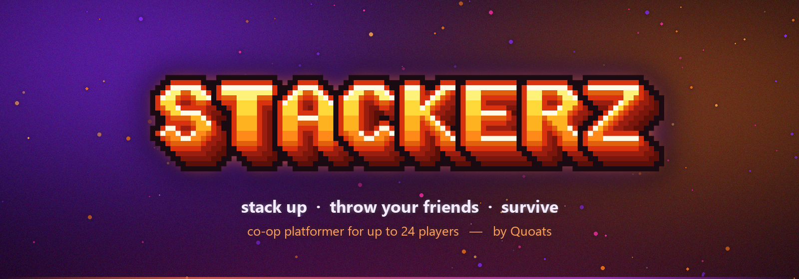

### A chaotic co-op platformer for up to 24 players. Stack up, throw your friends, survive.

**[quoats.xyz](https://quoats.xyz/#game)** &nbsp;·&nbsp; **[Every version](https://github.com/Quoats/STACKERZ/releases)** &nbsp;·&nbsp; **[Report a bug](https://github.com/Quoats/STACKERZ/issues/new)**

---

## The game

Run, jump and stack on top of each other through world maps full of levels, enemies, bosses and puzzles. Pick your friends up and throw them across gaps, ride mounts, and grab power-ups that stack together.

- **Up to 12 players on one PC** (keyboards, Xbox and Switch-style pads, even Wii Remotes) and **up to 24 online** with host / join
- **8 worlds** of levels, each ending in a boss fight
- World maps, mounts and stacking power-ups
- PvP toggle and a full **Battle mode** with item boxes and arenas
- A built-in **World Editor** for making your own levels
- Every sprite, sound and the font are made from scratch for this game: no asset packs

## Screenshots

<table>
  <tr>
    <td width="50%"><a href="media/screens/title-tower.jpg">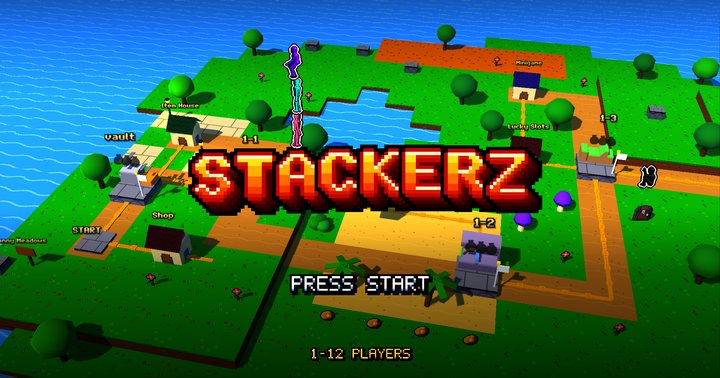</a> <b>Title screen:</b> the tower stacks up on the logo</td>
    <td width="50%"><a href="media/screens/world-1-map-card.jpg">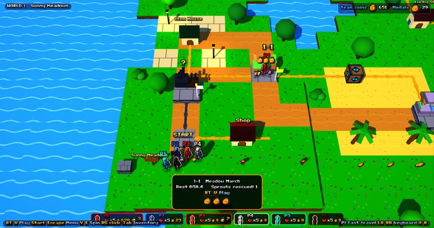</a> <b>World 1 map:</b> walk the overworld and pick a level</td>
  </tr>
  <tr>
    <td><a href="media/screens/w1-1.jpg">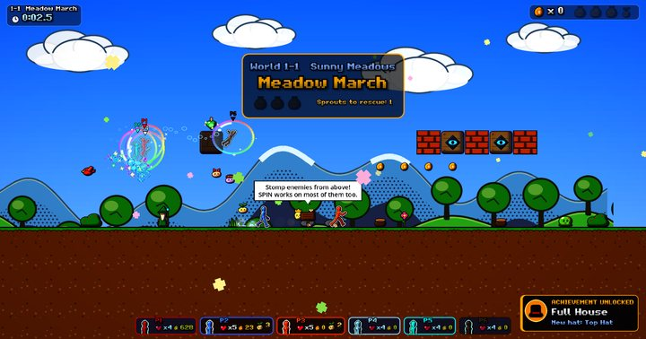</a> <b>Meadow March</b> (World 1-1) with six players</td>
    <td><a href="media/screens/lobby24.jpg">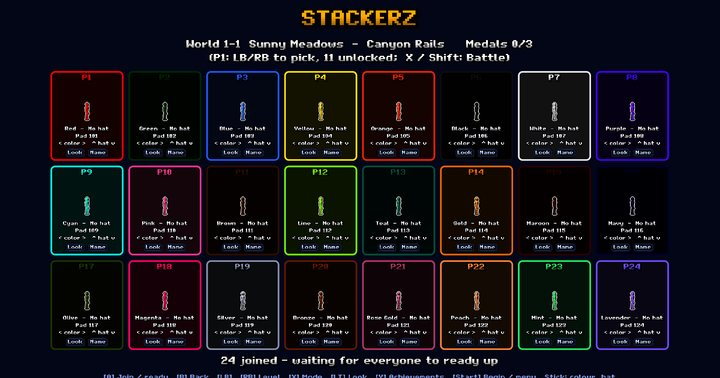</a> <b>Online lobby</b> with all 24 players in</td>
  </tr>
  <tr>
    <td><a href="media/screens/boss-w1-4-fight.jpg">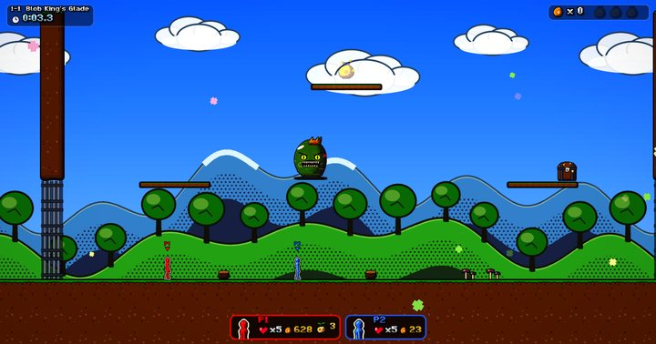</a> <b>Boss fight:</b> The Blob King</td>
    <td><a href="media/screens/boss-w6-4-fight.jpg">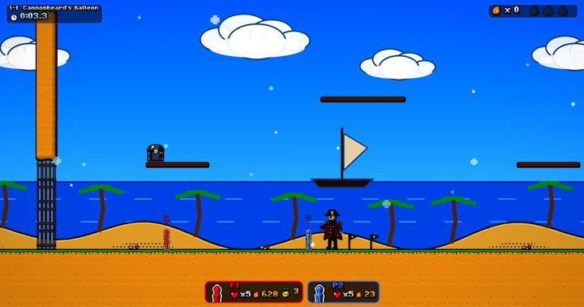</a> <b>Boss fight:</b> Captain Cannonbeard</td>
  </tr>
  <tr>
    <td><a href="media/screens/boss-roost-4-fight.jpg">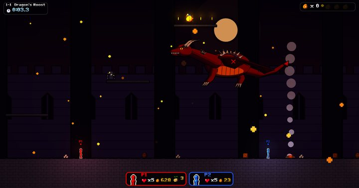</a> <b>Boss fight:</b> The Sky Dragon</td>
    <td><a href="media/screens/boss-w5-4-fight.jpg">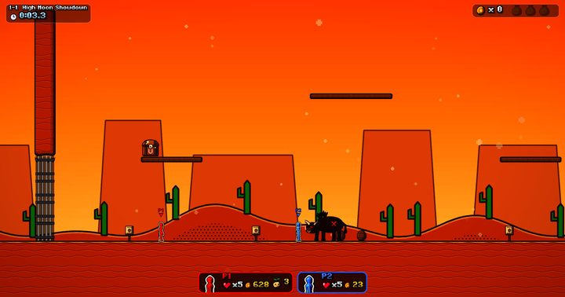</a> <b>Boss fight:</b> El Toro</td>
  </tr>
  <tr>
    <td><a href="media/screens/boss-w8-4-fight.jpg">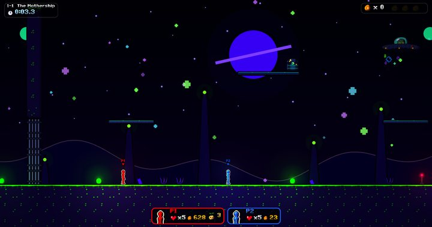</a> <b>Boss fight:</b> The Zorb Mothership</td>
    <td><a href="media/screens/world-editor-3d.jpg">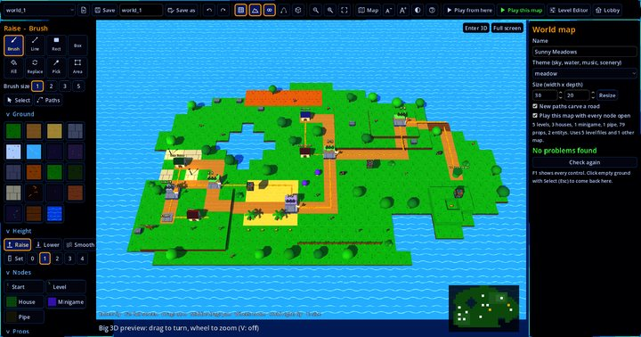</a> <b>World Editor</b> with the 3D preview</td>
  </tr>
</table>

## How to play

1. **[Download STACKERZ-windows.zip](https://github.com/Quoats/STACKERZ/releases/latest/download/STACKERZ-windows.zip)** (Windows, 64-bit).
2. Unzip it anywhere and double-click **`STACKERZ.exe`**. No install.
3. If Windows says *"Windows protected your PC"*, click **More info → Run anyway** (the game isn't code-signed).

`HOW TO PLAY.txt` inside the zip has everything. The short version:

| | Move | Jump | Run | Grab / throw | Spin | Crouch | Pause |
|---|---|---|---|---|---|---|---|
| **Gamepad** | stick | A | X | RB | Y | LT | Start |
| **Keyboard** | A / D | Space or W | Shift | F | E | C | Esc |
| **Keyboard 2** | arrows | Up | Numpad 1 | Numpad 2 | Numpad 3 | | |

In the lobby, **A / Space** joins and readies up, left / right picks a color, up / down picks a hat, and **Start / Enter** begins once everyone's ready. F11 toggles fullscreen.

<b>Playing online</b>

- Everyone needs the **exact same build**. It's shown at the bottom right of the title screen.
- **Host:** in the lobby, leave the port at 7777 and click **Host**. The line under the buttons tells you the address friends should use. If your router won't open the port, forward UDP 7777 or use a free LAN VPN (Radmin VPN, ZeroTier or Tailscale).
- **Friends:** join your own players in the lobby first, type the host's IP and port next to "IP", click **Join** and ready up.
- The first time you host, allow STACKERZ through Windows Firewall.

<b>Wii Remotes and extra keyboards</b>

- **Wii Remote (+ Nunchuk):** pair it once with `wiimote_pair.exe` (or "Pair Wii Remote" in the lobby) and press the red SYNC button. Keep `wiimote_helper.exe` next to the game.
- **Separate keyboards:** turn on "Separate keyboards" in Settings, then press Space on another keyboard to join as a new player. Keep `keyboard_helper.exe` next to the game.

## About me

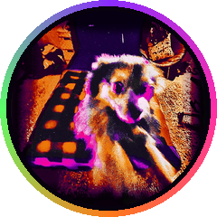

**Quoats**, an independent artist out of Texas. Every song, every beat (as **Woats**) and every cover is made by me, released on **XZELSIOR**. STACKERZ is my game: built in Godot, with every sprite, sound and font made for it from scratch.

Music, videos, art and game updates all live on **[quoats.xyz](https://quoats.xyz)**.

 

---

STACKERZ © Quoats · XZELSIOR. This repository holds the game's downloadable builds.

